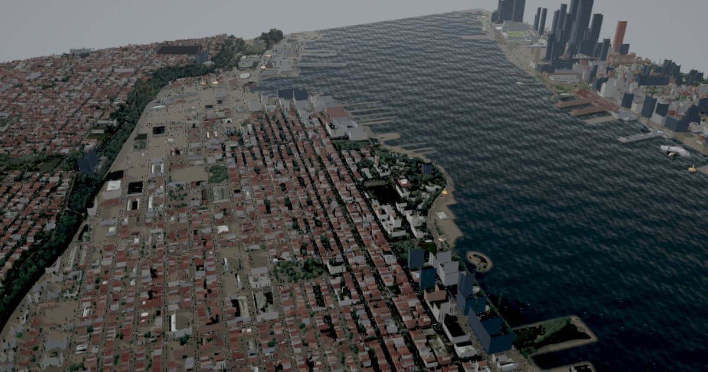

# FloodTwin

A GPU flood model of Hoboken, New Jersey and Manhattan's West Side that runs in the browser. It solves the shallow-water equations on a 4 m grid in real time, from lidar terrain and every building footprint, and estimates damage and loss building by building.

**Open it:** https://alanhuang116.github.io/floodtwin/
**Methodology:** https://alanhuang116.github.io/floodtwin/methodology.html



## What It Does

- **Simulates** coastal surge, rainfall and compound floods with a local inertial shallow-water solver (Bates et al. 2010, de Almeida et al. 2012) written as WebGL 2 shaders: 940,992 cells at 4 m, with 2 m and 8 m options.
- **Replays Hurricane Sandy** from the NOAA Battery water-level record and compares the result with 10 USGS high-water marks (mean absolute error 0.17 m with the waterfront correction, 0.29 m without).
- **Tests scenarios:** six presets (Sandy, the 1-in-100-year coastal flood with and without sea level rise, the NOAA Atlas 14 100-year cloudburst, an Ida-like downpour, compound surge and rain), with every parameter editable: surge peak, duration and tide timing, sea level rise, rainfall from the Atlas 14 table, drainage and infiltration, roughness, grid resolution and numerical settings.
- **Tests defences:** a wall along the Hoboken waterfront at any crest, barriers drawn on the map, and pumps.
- **Shows hazard:** depth, velocity with flow tracers, DEFRA FD2320 hazard to people, peak depth, arrival time, and FEMA flood zones.
- **Estimates losses:** 8,901 buildings carry National Structure Inventory values and FloodVuln Global damage curves (fitted to 1.86 million NFIP claims), with the 10th to 90th percentile range, residents affected and flooded vehicles.
- **Scores portfolios:** load a CSV of properties (or the demo mortgage book) to get depth, damage, expected loss and loan-to-value after the event for each one.
- **Exports** building results, the peak depth grid (ESRI ASCII, UTM 18N), time series, portfolio results and images, and makes share links that reopen the same scenario and view.

## Running Locally

The site is static. Serve the `web` folder over HTTP and open it in a browser with WebGL 2 (Chrome, Edge, Firefox or Safari on a computer with a GPU):

```
cd web
python -m http.server 8000
```

Then open http://localhost:8000. `docs/` is a copy of `web/` for GitHub Pages; refresh it with `python scripts/build_site.py`.

## Repository Layout

| Path | Contents |
|---|---|
| `web/` | The application: `index.html`, `methodology.html`, `js/` (solver, scene, interface), `css/`, `data/` (prepared inputs, 12.5 MB), `vendor/three/` (three.js r186) |
| `scripts/` | Data pipeline: download and prepare terrain, imagery, buildings, events and validation |
| `sim/solver.py` | Reference CPU implementation of the scheme, used to check the GPU solver |
| `tests/` | Analytic solver tests, GPU against CPU parity, headless scenario runs, screenshots and throughput |
| `data/processed/` | Validation runs (the raw `data/raw/` downloads are not in the repository) |

## Rebuilding the Data

The prepared files in `web/data/` are committed, so rebuilding is only needed to change the domain or the sources. With Python 3.11 and `numpy`, `scipy`, `shapely`, `pyproj`, `pillow`, `tifffile`, `numba`, and `laspy` with `lazrs` (lidar), run in order:

```
python scripts/fetch_dem.py        # USGS 3DEP 1 m DEM
python scripts/fetch_ortho.py      # NAIP 0.5 m imagery
python scripts/fetch_vectors.py    # OSM, NSI, NOAA, USGS, FEMA, Atlas 14
python scripts/fetch_lidar.py      # 3DEP lidar point clouds (large)
python scripts/build_terrain.py
python scripts/build_city.py
python scripts/build_events.py
python scripts/build_meta.py
python tests/run_scenario.py sandy 4    # validation runs, then:
python scripts/build_validation.py
```

## Tests

```
python tests/test_solver.py       # lake at rest, mass conservation, normal depth, boundary filling
python tests/gpu_parity.py        # GPU against the CPU reference on the real terrain
python tests/run_scenario.py sandy 4
```

The browser tests drive Microsoft Edge in headless mode (`tests/browser.py`).

## Data and Licences

US federal data (USGS 3DEP, NOAA CO-OPS and Atlas 14, USGS STN, USDA NAIP, FEMA NFHL, USACE NSI) are in the public domain. Building footprints and streets are © OpenStreetMap contributors under the Open Database Licence. three.js is MIT-licensed. Geist and Geist Mono are under the SIL Open Font Licence. Damage curves are from [FloodVuln Global](https://alanhuang116.github.io/floodvuln/).

Results are model estimates for illustration and screening. They are not a substitute for a site survey, an engineering assessment or an official flood map. See the [methodology](https://alanhuang116.github.io/floodtwin/methodology.html#limitations) for the assumptions and limitations.

Built by [Entanglix](https://entanglix.tech/).
